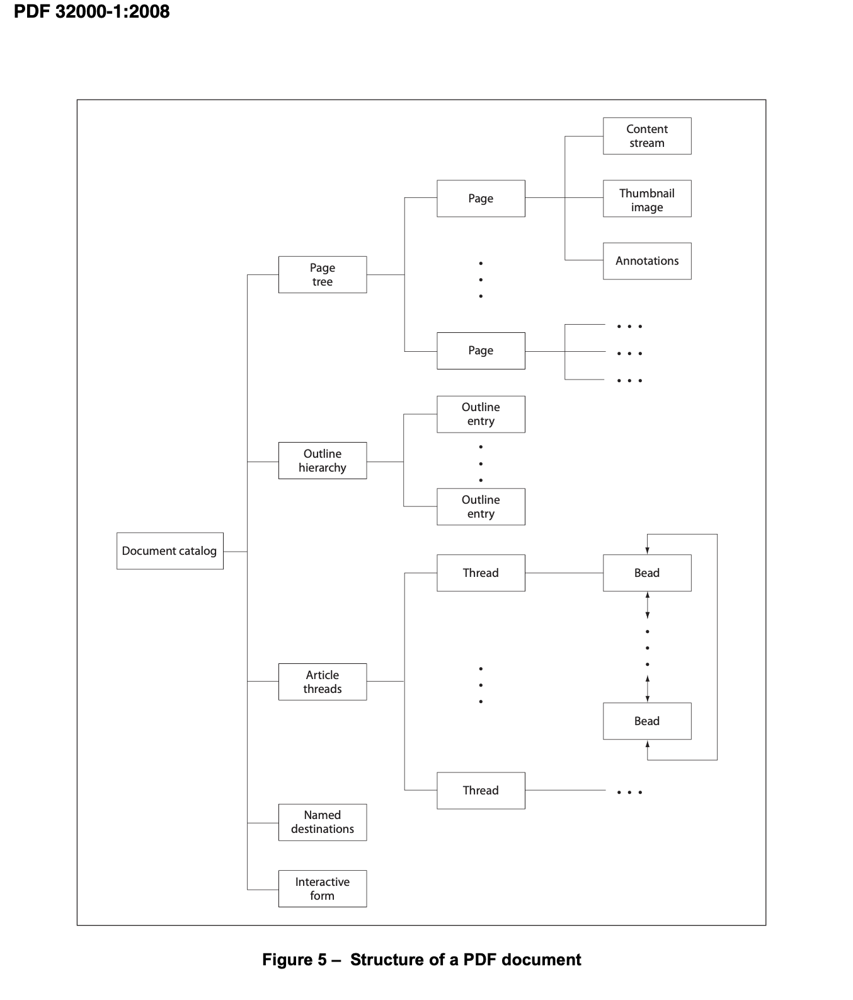

# Consider to vibe code a pdf-walker C++ console app?

```#9fe36d28```

## 20261104

I find myself needing to peek into pdf:s from tools like my book keeping app cratchit.

Now in the age of AI-tooling I wonder i I can design a small C++ code library and a console app to 'walk' pdf-files.

* I want the walker to 'walk' the structure of the pdf with a 'path' and 'content'.
* A client can use the walker to inspect the pdf-file as a composite structure.
* The 'path' shall be sufficient for the client to be able to determine what part of the pdf file structure is currently provided.
* The 'content' shall be sufficient for the client to process it in some form.
* The main focus of tge walker is to walk the pdf text content.
* The walker shall present the pdf text structure  'path' and 'content' so that a client shall be able to produce a raw text representation of the pdf.
* If possible the walker shall present the text structure of a pdf with 'path' and 'content' so that a client can process it into a markdown representation.

I want the C++ code and console app to be self-contained in modern C++.

* Cross platform with cmake build.
* Consume packages from conan package manager (where appropriate)

As a test during development I will copy pdf:s into a local _Resources folder

* Example vouchers from my company books in _vouchers
* Example e-books in _e-books 

I now browsed the web and found what seems to be the published PDF document specs?

* [PDF32000_2008.pdf](https://web.archive.org/web/20141020130815/http://wwwimages.adobe.com/content/dam/Adobe/en/devnet/pdf/pdfs/PDF32000_2008.pdf)

    * In here I found a graph over a pdf document structure?



Anyhow. I chatted with Claude about making an iterable pdf document model.

* I wanted a path that only represents the path (and actual referenced element is looked up)

I looked at the code and we are still not there?

Anyhow, I have now continued and made Claude do an app that lists level 1 and 2 of the pdf-document with a 'peek' column.

```sh
kjell-olovhogdahl@MacBook-Pro ~/Documents/GitHub/plaiground/session/9fe36d28 % ./walk_pdf/build/Debug/walk_pdf _Resources/_vouchers/62600012236149.pdf                                
         0     489246  /rev[0]                  53 elements: 48 objects, xref, trailer
         0          8  /rev[0]/header           version 1.4
         9        167  /rev[0]/obj[1]           << /Title (.. I n v o i c e) /Creator (.. w k h t m l t o...
       177         94  /rev[0]/obj[3]           << /Type /ExtGState /SA true /SM 0.02 /ca 1.0 /CA 1.0 /AI...
       272         36  /rev[0]/obj[4]           [/Pattern /DeviceRGB]
       309      45450  /rev[0]/obj[6]           << /Type /XObject /Subt... + stream <45281 bytes, DCTDecode>
     45760         20  /rev[0]/obj[7]           45281
     45781       1383  /rev[0]/obj[9]           << /Type /XObject /Sub... + stream <1212 bytes, FlateDecode>
     47165         20  /rev[0]/obj[10]          1212
     47186       6445  /rev[0]/obj[11]          << /Type /XObject /Subty... + stream <6263 bytes, DCTDecode>
     53632         20  /rev[0]/obj[12]          6263
     53653         43  /rev[0]/obj[14]          [0 /XYZ 81 813.500000 0]
     53697         44  /rev[0]/obj[15]          [0 /XYZ 31.5000000 743 0]
     53742         44  /rev[0]/obj[16]          [0 /XYZ 189.750000 743 0]
     53787         51  /rev[0]/obj[17]          [0 /XYZ 189.750000 709.250000 0]
     53839         51  /rev[0]/obj[18]          [0 /XYZ 31.5000000 709.250000 0]
     53891         51  /rev[0]/obj[19]          [0 /XYZ 189.750000 675.500000 0]
     53943         51  /rev[0]/obj[20]          [0 /XYZ 31.5000000 605.750000 0]
     53995         51  /rev[0]/obj[21]          [0 /XYZ 408.750000 422.750000 0]
     54047         44  /rev[0]/obj[22]          [0 /XYZ 356.250000 254 0]
     54092        210  /rev[0]/obj[23]          << /__WKANCHOR_2 14 0 R /__WKANCHOR_4 15 0 R /__WKANCHOR_...
     54303        125  /rev[0]/obj[26]          <</Title (.. 6 2 6 0 0 0 1 2 2 3 6 1 4 9) /Parent 25 0 R ...
     54429        132  /rev[0]/obj[27]          <</Title (.. 2 4 9 , 0 0 . S E K) /Parent 25 0 R /Dest /_...
     54562        130  /rev[0]/obj[28]          <</Title (.. 5 3 4 3 - 2 7 9 5) /Parent 25 0 R /Dest /__W...
     54693        130  /rev[0]/obj[29]          <</Title (.. 6 2 , 2 5 . S E K) /Parent 25 0 R /Dest /__W...
     54824        122  /rev[0]/obj[32]          <</Title (.. F a k t u r a s p e c i f i k a t i o n) /Pa...
     54947        163  /rev[0]/obj[30]          <</Title (.. 3 1 1 , 2 5 . S E K) /Parent 25 0 R /Dest /_...
     55111        132  /rev[0]/obj[33]          <</Title (.. I n b e t a l n i n g / g i r e r i n g A V ...
     55244        186  /rev[0]/obj[31]          <</Title (.. S E 0 4 1 2 0 0 0 0 0 0 0 1 3 0 7 0 1 0 9 4 ...
     55431        127  /rev[0]/obj[25]          <</Title (.. F a k t u r a) /Parent 24 0 R /Dest /__WKANC...
     55559         62  /rev[0]/obj[24]          <</Type /Outlines /First 25 0 R /Last 25 0 R>>
     55622        103  /rev[0]/obj[34]          << /Type /Catalog /Pages 2 0 R /Outlines 24 0 R /PageMode...
     55726        120  /rev[0]/obj[5]           << /Type /Page /Parent 2 0 R /Contents 35 0 R /Resources ...
     55847        201  /rev[0]/obj[37]          << /ColorSpace << /PCSp 4 0 R /CSp /DeviceRGB /CSpg /Devi...
     56049         19  /rev[0]/obj[38]          [ ]
     56069     423950  /rev[0]/obj[35]          << /Length 36 0 R /F... + stream <423875 bytes, FlateDecode>
    480020         22  /rev[0]/obj[36]          423875
    480043        198  /rev[0]/obj[39]          << /Type /FontDescriptor /FontName /QNBAAA+OCRB /Flags 4 ...
    480242       1678  /rev[0]/obj[40]          << /Length1 2024 /Leng... + stream <1588 bytes, FlateDecode>
    481921         20  /rev[0]/obj[43]          1588
    481942        217  /rev[0]/obj[41]          << /Type /Font /Subtype /CIDFontType2 /BaseFont /OCRB /CI...
    482160        513  /rev[0]/obj[42]          << /Length 462 >> + stream <462 bytes>
    482674        130  /rev[0]/obj[13]          << /Type /Font /Subtype /Type0 /BaseFont /OCRB /Encoding ...
    482805        259  /rev[0]/obj[44]          << /Type /FontDescriptor /FontName /QSBAAA+DejaVuSans /Fl...
    483065       4227  /rev[0]/obj[45]          << /Length1 16036 /Len... + stream <4136 bytes, FlateDecode>
    487293         20  /rev[0]/obj[48]          4136
    487314        217  /rev[0]/obj[46]          << /Type /Font /Subtype /CIDFontType2 /BaseFont /DejaVuSa...
    487532        419  /rev[0]/obj[47]          << /Length 368 >> + stream <368 bytes>
    487952        135  /rev[0]/obj[8]           << /Type /Font /Subtype /Type0 /BaseFont /DejaVuSans /Enc...
    488088         97  /rev[0]/obj[2]           << /Type /Pages /Kids [ 5 0 R ] /Count 1 /ProcSet [/PDF /...
    488186        990  /rev[0]/xref[0]          49 entries, objects 0-48
    489176         47  /rev[0]/trailer[0]       << /Size 49 /Info 1 0 R /Root 34 0 R >>
    489224         16  /rev[0]/startxref[0]     488186
    489241          5  /rev[0]/eof[0]           
kjell-olovhogdahl@MacBook-Pro ~/Documents/GitHub/plaiground/session/9fe36d28 % 
```

I can still not read or understand it.

* But we are starting to see some text I think?

So what is next?

* Make the app recurse one level more?
* Can the design do this?

I now made Claude implement an API for client side recursion on path.

* main now recurse to default level 3 or user provided --depth
* The app now 'decodes' (?) elements to be able to recurse deeper
    * I am not sure I understand this but it seems recursion below obj requires 'decoding'?

```text
    487314        217  /rev[0]/obj[46]                  << /Type /Font /Subtype /CIDFontType2 /BaseFont /DejaVuSa...
    487332          5  /rev[0]/obj[46]/Type             /Font
    487347         13  /rev[0]/obj[46]/Subtype          /CIDFontType2
    487371         11  /rev[0]/obj[46]/BaseFont         /DejaVuSans
    487398         58  /rev[0]/obj[46]/CIDSystemInfo    << /Registry (Adobe) /Ordering (Identity) /Supplement 0 >>
    487411          7  /rev[0]/obj[46]/CIDSystemInfo/Registry (Adobe)
    487429         10  /rev[0]/obj[46]/CIDSystemInfo/Ordering (Identity)
    487452          1  /rev[0]/obj[46]/CIDSystemInfo/Supplement 0
    487473          6  /rev[0]/obj[46]/FontDescriptor   44 0 R
    487493          9  /rev[0]/obj[46]/CIDToGIDMap      /Identity
    487506         15  /rev[0]/obj[46]/W                [0 [595 315 ] ]
    487507          1  /rev[0]/obj[46]/W/[0]            0
    487509         10  /rev[0]/obj[46]/W/[1]            [595 315 ]
    487510          3  /rev[0]/obj[46]/W/[1]/[0]        595
    487514          3  /rev[0]/obj[46]/W/[1]/[1]        315

```

I now made Claude bring in text transcoding from session/60cae9fe/cratchit.

* I vibe coded UTF16 support.
* Claude (AGAIN!) extended push to return optional surrogate pair code points.
* I asked Claude to remove it again.

I also now see that Claude has implement to/from Unicode buffer.

* BUT I tried very hard when vibe coding this transcoding library to prohibit ANY unicode buffer!

    * My idea is to transcode over 'push' encoding-to-unicode-to-encoding
    * In this way we can use Unicode as the intermediate code-point
    * But only buffer unicode code points if the target is actual Unicode!
    * So on platforms using UTF8 in terminal we can transcode from any input to UTF8 and never buffer the actual Unicode code points?

I wonder if I should make Claude fix this now?

I decided to adress the encryption of the text in my e-books first.

* It seems the mechanism is that they decrypt with an empty password and known algorithm.
* AND the pdf carries a 'permission' flag that states 'view and print' is ok but 'extract' is NOT.
* And pdf readers and web browser adhere to the permission flag.
    * This explains why I can't copy text or graphics when viewing the e-book.

I do NOT like this!

* I understand the business side of this encryption scheme and permission mechanism.
* But it is MY document. I should be allowed to use the information for my own use with a bit more freedom?
* I mean, nothing stops me from telling others about what is in my e-book?
* And the web is full of examples based on information in the book.
* So as long as I don't clone the book and distribute it in my own format I think I should be able to be able to at least cut-and-paste for my own use?

I have to think about this.

Anyhow, Claude seems to have been able to decrypt fo structure peeking for now?

```text
What's new:
- crypto library (src/crypto/): our own MD5 and RC4. They're tested against the official MD5 test suite and known RC4 vectors, so no OpenSSL is needed.
- src/security.*: the PDF spec's algorithms for computing the file key from the empty password, checking it against /U, and deriving each object's key. Both RC4 variants are supported (40-bit R2 and up to 128-bit R3/R4).
...
```

I now Vibe coded so From/To UnicodeBuffer are now named Decoder/Encoder (so at least the naming does not violate the transcoding library 'never buffer Unicode code points' rule)

And now I have vibe coded parsing of text blocks into its 'parts'.

* BT[i] for each text block.
* op[i] for each operation in a block, without its BT and ET.
* [i] for each operand, which reuses the existing array-item segment. So a TJ array's strings can be reached too, e.g. …/op[3]/[0]/[2].

Now I don't fully understand this yet. But I get the gist of it.

* And the important thing I focus on now is that we are now at 'Text Blocks' which is comforting!

Now I learned that a pdf stores 'text' as ' bytes inside Tj/TJ strings are character codes in the font's own encoding'.

* So to map the 'text' to a character set encoding we understand the pdf reader needs to lookup the font and apply its mapping (to Unicode it seems).

I now feel VERY GOOD about this exercise.

* The path-listing is now understandable about mapping to fonts and unicode mapping.

    * E.g., 'object 8'

    ```text
        ...
        487952        135  /rev[0]/obj[8]                   << /Type /Font /Subtype /Type0 /BaseFont /DejaVuSans /Enc...
        487969          5  /rev[0]/obj[8]/Type              /Font
        487984          6  /rev[0]/obj[8]/Subtype           /Type0
        488001         11  /rev[0]/obj[8]/BaseFont          /DejaVuSans
        488023         11  /rev[0]/obj[8]/Encoding          /Identity-H
        488052          8  /rev[0]/obj[8]/DescendantFonts   [46 0 R]
        488053          6  /rev[0]/obj[8]/DescendantFonts/[0] 46 0 R -> /rev[0]/obj[46]
        488072          6  /rev[0]/obj[8]/ToUnicode         47 0 R -> /rev[0]/obj[47]
        ...
    ```

    * I read this as 'decoded' shows how the parts are represented as text
    * And 'ToUnicode' is somehow defined at '/rev[0]/obj[47]'
    * I get the semantics I think!

    Now Claude seems to have integrated Adobe 'character sets' as mapping to Unicode.

    * It seems I was correct in 'baiting' with my own character set library first
    * This seems to have caused Claude to pick up the hint and build on it?

    So now Claude claims the app can map pdf text to text in a character set and encoding we can actually use!

    And now I understood something more about pdf text.

    * The text is 'placed' on the page with x,y coordinates!
    * So to assemble 'plain text' we need to know font size, spacing, page coordinates etc.

    Claude proposed a machinery for this so we end up with what is more-or-less a vector of strings (or a vector of vector of words).

    Lets see how this goes (fingers crossed)

    * AND - Am I glad I do not have to do this manually by myself!
    * Also: MY GOOD HOW 'LITTERED' PDFS ARE (for what we use them for...)

    Ok, so maybe we need this complexity to pass around good looking document?

    * Still - It just FEELS overkill?

    WOW! The app now seems to be able to dump plain text from a pdf!

    And as the final task for today - I vibe coded an API walk_pdf.hpp/cpp as a candidate for an entry point when merged into some cratchit or other c++ code base.